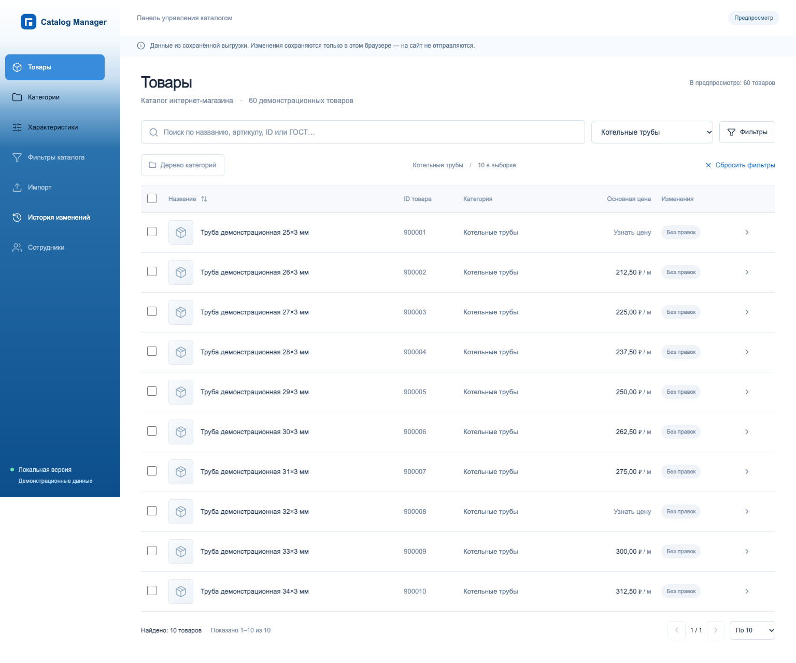

# Catalog Manager

Панель управления товарами на **Vue 3, TypeScript и Vite**. Портфолио разработки интерфейса и серверной интеграции с WordPress / WooCommerce.

В этом репозитории используются **60 вымышленных товаров**. Паролей, серверных доступов, настоящих выгрузок товаров, внутренних отчётов и базы заказчика здесь нет. Логотип нейтральный.



## Быстрый запуск

Нужен Node.js 22.12+ либо актуальная совместимая версия.

```sh
npm ci
npm run dev
```

Открыть http://localhost:5173. Сервер и авторизация не требуются. Изменения сохраняются в localStorage этого браузера. Вернуть исходное состояние можно через историю либо очистку локальных данных браузера.

## Что можно посмотреть без сервера

- Поиск, категории, фильтры наличия цены и диапазона цен, сортировка, страницы.
- Отдельная карточка товара: основные данные, цены, характеристики.
- Пересчёт производных цен по заданным коэффициентам.
- Массовая правка выбранных товаров с предпросмотром.
- Локальные черновики, журнал изменений и последовательная отмена.
- Адаптивный интерфейс и боковая панель с переходом от белого к синему сверху вниз.

## Серверная часть

В `server/` сохранён исходный код API, реализованный для отдельной тестовой среды WordPress / WooCommerce. Он включает cookie/nonce-аутентификацию, роли сотрудников, создание товаров и категорий, фотографии, справочники, настройку фильтров разделов, импорт XLSX/CSV, массовые операции и журнал с отменой.

Эти функции требуют настроенного сервера и **не имитируются как работающие в локальной демонстрации**. Запись разрешена только с флагом `UKM_AUDIT_STAGE`. Для полноценной интеграции сервер ожидает адаптеры расчёта единиц (`UralKM_Cart_Units`, `Ukm_Catalog_Base_Price`) и фильтров (`ukmf_*`) из исходного проекта. Они не входят в этот публичный репозиторий. Серверные файлы — пример интеграционной части, а не готовый универсальный плагин для установки на любой магазин.

Приватные SSH-скрипты, реальные адреса сервера и настройки развёртывания исключены. Без собственной интеграции оставьте демонстрационный режим.

## Архитектура

- `src/App.vue` — навигация и экран каталога.
- `src/components/` — таблица, редактор, импорт, справочники, фотографии и сотрудники.
- `src/composables/useCatalog.ts` — состояние и действия каталога.
- `src/domain/` — типы, проверка данных, клиент API и чтение файлов.
- `src/data/catalog-snapshot.json` — синтетические демонстрационные данные.
- `server/` — серверный API для тестовой интеграции.

## Проверки

```sh
npm run build
npx playwright install chromium
npm test
```

Тесты этого репозитория проверяют локальную демонстрацию. Приватные интеграционные тесты, учётные записи и результаты с реального сервера не публикуются.

Репозиторий представлен как портфолио исходного кода; он не содержит лицензии на свободное переиспользование.
